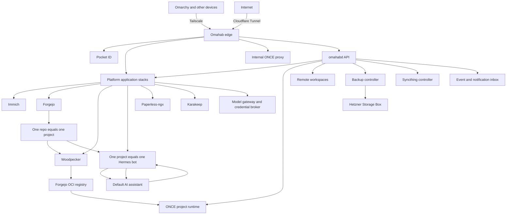

# Omahab Design

Status: consolidated product and architecture design

## 1. Product identity

The product name is **Omahab**. Technical identifiers are lowercase:

- CLI: `omahab`
- Daemon: `omahabd`
- Default paths: `/etc/omahab`, `/var/lib/omahab`, and `/srv/omahab`
- Repository and package names: lowercase `omahab`


Omahab is an opinionated, easy-to-install home server environment inspired by Omarchy's product principles: coherent defaults, minimal setup, standard tools underneath, excellent CLI support, and a deliberately designed end-to-end experience.

Suggested tagline:

> The opinionated home server.

During setup, users name their primary AI assistant. The default is:

- Display name: `AI`
- Slug: `ai`
- Stable Hermes profile ID: `default`
- Web address: `https://ai.<domain>`
- Email address: `ai@<domain>`

Changing the display name changes generated aliases and UI copy, but not the stable Hermes profile or its memory.

## 2. Product principles

1. Provide a paved road rather than a configuration buffet.
2. Use stable, familiar infrastructure beneath the opinionated interface.
3. Keep services private by default.
4. Make public exposure explicit, inspectable, and reversible.
5. Treat backup and verified recovery as product features.
6. Give every dashboard operation a stable CLI/API equivalent.
7. Make structured output available for agents.
8. Keep one-node operation excellent before considering clustering.
9. Pin, stage, health-check, and roll back updates.
10. Keep secrets out of Git, logs, Docker labels, and user-visible configuration.
11. Treat AI input, email, web content, repositories, and documents as potentially untrusted.
12. Prefer clean boundaries over forcing every workload through one runtime.
13. Avoid Kubernetes in the initial product.
14. Avoid local generative AI initially; remote providers are the default. Small local embedding models are an explicit exception.
15. Build as community software, not a commercial appliance or hosted control plane.

## 3. Initial scope

Omahab initially targets a single household with:

- one technical administrator;
- optional household members;
- one Omahab server;
- amd64 or arm64 hardware;
- either bare metal or a Proxmox virtual machine;
- Tailscale for private remote access;
- a custom domain hosted on Cloudflare;
- remote LLM providers and supported subscription OAuth;
- an Omarchy desktop companion.

The system supports data on the same disk as the OS. A separate data disk is recommended but not required; the first-run wizard can dedicate a disk to media or data after boot.

Omahab does not manage RAID or ZFS. On Proxmox, storage redundancy and snapshots remain Proxmox responsibilities. Home Assistant should normally run in its own Home Assistant OS VM and be connected to Omahab as an external integration.

Initial non-goals:

- Kubernetes;
- clustering and high availability;
- NAS/RAID/ZFS administration;
- media piracy stacks;
- local generative LLM serving;
- macOS or Windows companion applications;
- adopting arbitrary existing Docker hosts;
- self-hosting a general-purpose SMTP mailbox;
- consumer budgeting applications without reliable bank integration.

The host is now a declarative NixOS closure (see §5): the OS, all Omahab binaries, and every platform application form one generation-managed system. Docker remains only for user-project deploys (ONCE) and CI job containers.

## 4. System architecture



### 4.1 Host control plane

`omahabd` is a host-level service. It owns:

- installation and instance identity;
- platform application lifecycle;
- ONCE project deployment orchestration;
- the authenticated control API;
- exposure state and Cloudflare desired state;
- project metadata;
- Pocket ID integration;
- secret storage and projection;
- model provider credentials;
- backups and restore records;
- Syncthing folder metadata;
- remote workspace lifecycle;
- event history and notification policy;
- external integrations such as Home Assistant;
- application and host health.

Use SQLite for control-plane state initially. Application data remains in application-specific stores. SQLite is not a dumping ground for Paperless documents, photos, Git repositories, or application databases.

Recommended storage layout:

```text
/etc/omahab/
  configuration and non-secret host policy

/var/lib/omahab/
  control-plane database
  encrypted secrets
  instance identity
  install and update journal

/srv/omahab/
  apps/
  projects/
  sync/
  workspaces/
  backups/
  derived-indexes/
```

### 4.2 Implementation stack

Omahab-owned host software uses Go as its primary language. `omahab`, `omahabd`, `omahab-clientd`, and the installation, application, deployment, Cloudflare, backup, synchronization, workspace, event, email-processing, and health controllers are Go binaries. Use the current stable Go release pinned by each Omahab release.

The authenticated control API uses HTTP/JSON with an OpenAPI contract. Use the Go standard library with Chi for routing, Cobra for CLI commands, and hand-written request/response types in `internal/apitypes` (aliased by `internal/api/types.go`) mirrored by the hand-maintained `web/src/api/types.ts`; OpenAPI is descriptive. Use ordinary HTTP for commands and queries, Server-Sent Events for control-plane event streams, and WebSockets only where bidirectional behavior requires them, including Hermes's existing JSON-RPC transport. Do not add gRPC initially.

Use `database/sql` with `modernc.org/sqlite` so SQLite does not require a C toolchain, `sqlc` for typed queries where adopted (`internal/store` is generated; `internal/apps`, `internal/secrets`, `internal/projects`, `internal/providers` remain hand-written `database/sql` until migrated per TODO P2-1), and explicit schema migrations. Durable jobs, desired and observed state, releases, and normalized events remain SQLite-backed state machines. Do not add a message broker or an external workflow engine for the initial single-node product; the one exception is a local Redis on 6379 as the LiteLLM cache (`services.redis.servers.omahab` in `nix/apps.nix`).

Browser applications use TypeScript, React, and Vite, with React Router, TanStack Query, and a hand-written API client (`web/src/api/client.ts` with aliases mirroring OpenAPI operationIds; OpenAPI stays descriptive, no generated client). Build static assets served by the Go control plane or Caddy; do not require a Node.js server in production. Reuse Hermes Desktop's existing React components and styling conventions rather than creating a second design system.

The Omarchy shell plugin remains a thin QML/JavaScript presentation layer over `omahab-clientd`. The Cloudflare Email Worker remains a minimal native TypeScript edge adapter. Local embedding inference remains an isolated Python worker because its model, tokenizer, and ONNX ecosystem are materially stronger there. The closure also ships LiteLLM (Python service) and the Hermes OCI container as first-class runtimes alongside the Go binaries.

Language consolidation must not collapse failure domains. Embedding inference and other resource-heavy or native-library workloads remain outside `omahabd`, even when controlled through its API. Omahab orchestrates Caddy, `cloudflared`, Tailscale, restic, Syncthing, DevPod, `hass-cli`, Hermes, Redis (LiteLLM cache only), and the model gateway as upstream components rather than reimplementing them.

## 5. Host OS and installation

### 5.1 Base OS

The host is **NixOS**: the OS, Omahab's binaries, and every platform application are one declarative closure built from the repository flake (`nix/module.nix` + `nix/apps.nix`, pinned by `flake.lock`).

Reasons:

- the whole appliance — kernel, systemd units, nftables, sshd, tailscale, docker/podman, and the application services — is versioned as one generation with atomic switch and rollback;
- application versions track the pinned nixpkgs revision, so the flake lock is the release gate;
- no imperative package installation, no unattended-upgrades divergence, no installer journal — `nixos-rebuild` is the safety net;
- amd64 installer ISO and appliance configs; Go/Node packages additionally build for arm64, but there is no aarch64 ISO output.

Docker remains for user-project deploys (ONCE) and the Hermes container; CI job containers run on the rootless podman builder. Platform applications are otherwise native systemd services.

### 5.2 Installation form

Omahab ships a bootable installer ISO and a NixOS module (there is no `image-qcow` target; Proxmox installs boot the ISO):

```sh
nix build .#image-iso     # bootable installer ISO
```

Install paths in code: the guided `omahab install` wizard on the ISO driving the `omahab-install-disk` backend (`scripts/install-disk.sh`: GPT/ESP layout, `--placement lan|vps`, `--selection-file`, `--network-file`, `--resume-install`), the dev VM (`apps.vm`), and the `nixosConfigurations.omahab-installed` template rewritten in-guest.

Or add to any NixOS host:

```nix
imports = [ github:davidgilesgt/omahab#nixosModules.omahab ];
services.omahab.enable = true;
```

`services.omahab.enable` is the primary switch (alongside `package`, `webPackage`, `catalogPackage`, `embeddingWorkerPackage`, `listen`, `placement`, `releaseRef`, `releaseURL`, `adminUser` in `nix/module.nix`); domain, tokens, and per-household values are runtime state, never in a `.nix` file.

### 5.3 First-boot access

On first boot the console (tty1) shows the LAN panel URL and the 8-character panel token.
There is no claim step. The panel requires its 8-character token on every placement and source, including LAN and tailnet.
The token is stored at `/var/lib/omahab/api.token` (root 0600).
At startup, the daemon copies it to `~/.config/omahab/token` for the configured admin user.
Backups lead the setup checklist (§5.4): the first step restores from an earlier server or starts fresh with a recovery phrase plus repository. SSH keys come from the installer's `--authorized-keys-file` (optional) and are extended as the next setup-checklist
step; Tailscale enrollment lives on the checklist too. `omahab setup` is the SSH
fallback for the Tailscale + Cloudflare-domain/token part of the flow (it does not manage SSH keys; key provisioning lives in the `install`/`omahab-install-disk` path).

### 5.4 Strict appliance posture

The system remains an appliance: it does not adopt arbitrary existing servers. Fresh-image boot is the only supported path. Backups are the FIRST setup step: the box asks "Do you have a recovery phrase from an earlier Omahab server?" — "Set up a new server" walks the 24-word phrase ritual (saved-ack) then repository creation (Hetzner Storage Box username+host+sub-account password once, or a generic restic URL; mode=create initializes the repository, first backup + verify run in the background). "Restore from backup" takes the phrase + Hetzner credentials (or generic repo), lists earlier instance directories under `./omahab/` via `POST /api/v1/recovery/instances` (the server returns the exact instance location; the client never builds sftp URLs), lists snapshots of that location, then restores server-config plus all app scopes (`include_apps=true`) or a chosen app-scope subset (server-config always included — app scopes require it) through the staged `omahab-restore` unit. After the swap the repository is attached (mode=attach, exact instance location) so backups continue into the same instance path; a verify runs afterwards so `recovery_tested` reflects the restored repository. A snapshot whose manifest `release_ref` differs from the running system is surfaced clearly before apply. Restore state is observable server-side (check `restore`: not_started | skipped | in_progress | completed | failed, persisted in `restore_setup_state.json`); the box is done when the restore completed or both `recovery_key` and `backups_configured` are ok. Before Tailscale the panel is plain HTTP on the LAN — the first step warns that the Hetzner password crosses the LAN and offers the SSH alternative `omahab recovery apply --repository …`. Restore never writes under `/nix` or `/etc`.

### 5.5 SSH-first setup and hardening

sshd is hardened declaratively in the installed closure: pubkey-only, no password or keyboard-interactive authentication, no root login. SSH keys are runtime state (the configured admin user's `~/.ssh/authorized_keys`, from the installer's `--authorized-keys-file` when given and extended as the first setup-checklist step); GitHub import is one-time and never continuously synchronized. Because sshd configuration is atomic with the generation, the installer-era rollback timers are obsolete — `nixos-rebuild test`/`switch --rollback` is the recovery mechanism. The ISO-live environment (`PermitRootLogin prohibit-password`) and the dev VM (passwords re-enabled) deliberately weaken this; the absolute claim below applies to the installed system only.

Default policy (from the module; `PubkeyAuthentication` is left to the nixpkgs sshd default):

```text
PasswordAuthentication no
KbdInteractiveAuthentication no
PermitRootLogin no
```

### 5.6 Host security baseline

- one NixOS closure, signed store paths, atomic generations with rollback;
- nftables default-deny inbound (`table inet omahab`); TCP 8484 on tailscale0 plus (lan placement) RFC1918/ULA/link-local LAN ranges, generic `iifname lo accept`, `br-*` from 172.30.0.2 to 8484 (Caddy dashboard upstream), and TCP 80/443 on tailscale0 for Caddy;
- no direct application port publication; native services bind loopback (Hermes runs with host networking and a loopback-only dashboard, not a published `127.0.0.1:8085` port mapping), Caddy is the only edge;
- Cloudflare Tunnel uses outbound connections;
- `omahabd` runs with `docker`/`podman` supplementary groups and CI builds use the rootless podman builder socket; the Docker socket is not restricted to `omahabd` alone in the closure;
- root-owned secret material under `/var/lib/omahab` (0700/0600), per-bundle env files 0640 with service-user group;
- key-only SSH; every administrative API request requires the panel token, including requests from LAN and tailnet sources;
- health and security checks through `omahab doctor`;
- explicit, supervised upgrades (`omahab system upgrade` with health gate + automatic rollback); no unattended rebuilds.

## 6. Application runtime boundaries

Omahab deliberately uses different runtime designs for different workload classes behind one control plane.

### 6.1 Platform applications

Platform applications are **native NixOS systemd services** managed by `omahabd` — Caddy, Pocket ID, Forgejo, Woodpecker (server + agent), Immich, Paperless-ngx, Karakeep, Syncthing, LiteLLM, the embedding worker, ntfy, and Hermes (which runs as an `oci-containers` unit).

A platform bundle entry in the curated catalog declares:

- `id`, `name`, `port`, `default_exposure`, `max_exposure`;
- `health_check` (HTTP probes against the loopback port map, `kind`/`path`/`port`);
- `data` (persistent-data locations, `name`/`path` pairs under `/srv/omahab` and `/var/lib/<svc>`);
- `backup` (`databases` listing the PostgreSQL logical databases scoped capture dumps and restores; consistency is the capture engine's job, not per-bundle commands);
- `oidc` (`supported`/`mode`/`provider` for native OIDC via Pocket ID);
- `resources` (`memory_mb` guidance);
- `default` (whether installed by default);
- `route` (subdomain prefix or templated host e.g. `ai.{{.Domain}}`);
- `dependencies`, `secret_sources`, `pipeline_image`;
- `units` (systemd units, required for every bundle).

Gated bundles (pocket-id, woodpecker, karakeep, litellm, hermes, forgejo, immich, paperless, ntfy; restic gates on its htpasswd instead) gate on their `appenv/<bundle>.env` file via `ConditionPathExists` (condition-skip, not failure); only caddy/syncthing read appenv as an optional `EnvironmentFile = [ "-..." ]` (or need none) and still start. `omahabd` renders the env file after enrollment and starts the gated units. Versions of native services track the nixpkgs pin — there is no per-app image update; `omahab system upgrade` switches the whole generation.

**Bundle layout (curated and custom).** Every bundle is one directory:
`bundles/<id>/bundle.json` (exactly one catalog Bundle object — the same
schema as the entries of the former single-file catalog; `source` is
loader-assigned, never present in files) and `bundles/<id>/module.nix`
(that app's NixOS config; shared gates and helpers live in
`nix/bundle-lib.nix`). The `omahab-catalog` flake package assembles
`catalog.json` from `bundles/*/bundle.json` at build time, so
`OMAHAB_CATALOG` keeps working unchanged; `nix/module.nix` imports every
`bundles/<id>/module.nix`.

**Custom bundles** live in a git repo at `/var/lib/omahab/bundles` with
the same layout (Forgejo is only a mirror; pushes are best-effort). The
daemon merges committed custom `bundle.json` files into the runtime
catalog (read at HEAD via `git show`, never the dirty worktree) and
rebuilds pass `--override-input bundles git+file:///var/lib/omahab/bundles?rev=<revision>`.
Apply validates intended changes before commit and the immutable revision after commit.
Build, switch, failure attribution, and health selection use that revision.
Custom validation: ids and units must
not collide with curated entries; ports must be unique and inside the
reserved custom range 20000–20999; `name`, `units`, `port`,
`health_check.kind`, and `module.nix` are required. Secrets never appear
in `module.nix` — env flows through `/var/lib/omahab/appenv/<id>.env`
with `ConditionPathExists`, exactly like curated gated bundles. `omahab
bundle list|add|remove|apply|status` and the admin API (panel-token
authenticated) drive the same `internal/bundles` service. A custom bundle
whose module fails a rebuild is reported by id, disabled via a committed
`bundles/<id>/disabled` marker, and the build retried once.

Panel applies run outside the daemon because a switch can restart `omahabd`.
POST `/api/v1/bundles/apply` saves the operation journal before nonblocking unit dispatch.
The `omahab-bundle-apply` unit runs `omahab bundle apply --apply-staged` as root.
Both CLI paths use the same `internal/bundles` apply implementation.
The journal records completion, failure, or successful rollback.
A successful unit apply restarts the daemon to load the committed catalog.
Failed CLI applies preserve a nonzero exit code in JSON mode.

### 6.2 Project applications

User-created projects deploy through ONCE by default.

Project records and releases use the shared store timestamp functions.
Timestamps use UTC RFC3339 with optional fractional seconds.
Project updates and release records use the stored project ID.
A project slug resolves to that ID before changes are saved.

Default project contract:

- one repository;
- one OCI image;
- HTTP on port 80;
- `/up` health endpoint;
- persistent state in `/storage`;
- SQLite preferred for small projects requiring a database;
- secrets supplied by Omahab;
- image built by Woodpecker;
- image stored by digest in the Forgejo registry.

A project that requires PostgreSQL, Redis, multiple workers, or several independently deployed components has outgrown the default ONCE contract. A future explicit stack runtime may support that case, but it must not be hidden inside a fake single-container image.

### 6.3 ONCE fork boundary

Omahab is not a supersized ONCE fork. ONCE's current assumptions include one container and volume per app, Docker labels as state, and application secrets in Docker-managed configuration. Those assumptions do not fit users, projects, external services, synchronization, identity, or the Omahab secrets model.

Maintain a narrow fork `third_party/once` in this repository (patch list in `third_party/once/PATCHES.md`) for project deployment. Patches 1–6 are applied in-tree; patch 7 (external-state interface) is deferred pending upstream. Keep its patch set suitable for upstreaming:

1. configurable proxy bind address, including loopback;
2. external TLS mode;
3. structured JSON output;
4. lifecycle event hooks;
5. external secrets-file support;
6. machine-readable deployment and health status;
7. an external-state interface if upstream accepts it (deferred).
Do not add Pocket ID, Immich, Hermes, DNS, device management, or project records to the ONCE fork.

Edge topology:

```text
Caddy/Omahab edge :80/:443
  ├── native platform services on 127.0.0.1:<port>
  ├── hermes container (host networking, loopback-only dashboard; no published 127.0.0.1:8085 port mapping)
  └── ONCE Kamal Proxy on 127.0.0.1:8080
        └── project containers
```

Caddy owns external TLS and host routing, routing to loopback upstreams (compose-internal DNS names no longer resolve). ONCE operates on a loopback internal port with internal TLS disabled.

### 6.4 Deployment flow

```text
git push
  -> Woodpecker tests and builds
  -> image pushed to Forgejo registry
  -> Woodpecker calls narrow omahabd release endpoint
  -> omahabd validates project, commit, and digest
  -> omahabd invokes ONCE
  -> health check
  -> release recorded
  -> previous release retained for rollback

Forgejo webhooks (pull_request, push) -> omahabd webhook ingress (HMAC-verified) -> scm.push / OnPullRequest -> event log (automated review in Step 6)
```

Woodpecker receives no host SSH key or broad Omahab administrator credential.

## 7. Networking, DNS, and exposure

### 7.1 Requirements

The supported happy path requires:

- a custom domain;
- DNS hosted by Cloudflare;
- Tailscale for private remote access.

Bootstrap and recovery cannot depend exclusively on the custom domain. The server remains reachable through its Tailscale IP, `*.ts.net` name, SSH, or local console.

### 7.2 Split-horizon DNS

Private services use public DNS records that resolve to the server's stable Tailscale IP; tailnet clients use those. LAN clients optionally resolve the same names through Technitium, the household resolver running on the server (`:53`, LAN-only), which answers `<app>.<domain>` with the host's LAN IP so Caddy serves 80/443 on the LAN with the same Cloudflare-issued certificates.

Public/tailnet state (unchanged):

```dns
ai.example.com       CNAME  <tunnel-id>.cfargotunnel.com   (shared/public)
ai.example.com       CNAME  ai.home.example.com            (private)
ai.home.example.com  A      100.x.y.z
```

LAN-only override (Technitium forwarder zone for the apex, FWD record = `this-server`):

```dns
ai.example.com       A      192.168.z.z   (host LAN IP, TTL 60)
```

omahabd owns this forwarder zone and reconciles it after exposure changes and once a minute: every exposed service hostname gets an A record at the first RFC1918 address on the host, A records for retired routes are removed, and everything else in the zone resolves through this server's normal path (Quad9 DoH forwarders plus blocklists still apply). Households opt in by pointing router DHCP DNS at the server; the host's own resolver prepends 127.0.0.1 with the router kept as fallback, so a Technitium outage never breaks the host or the household.

Consequences:

- LAN clients get app names without Tailscale; tailnet clients are unaffected (public Cloudflare records still point at the Tailscale IP);
- the nftables table admits 80/443 from RFC1918/ULA/link-local only on `lan` placement (comment strings distinct from the `:8484` dashboard rules, so Close LAN removes only the dashboard rules);
- the dashboard on `:8484` stays tailnet-only after Close LAN; HTTPS on 80/443 remains (the panel token gates administration either way);
- direct app ports (e.g. Jellyfin 8096) stay refused — Caddy is the only serving path;
- service names and tailnet IPs remain visible in public DNS, as before.

The installer and companion test resolution, certificate validity, routing, Tailscale identity, and Omahab instance identity before reporting success.


### 7.3 Exposure modes

Every service has one state:

1. **Private**: vanity CNAME resolves through the private `.home` record to the Tailscale IP.
2. **Shared**: Cloudflare Tunnel publishes the service behind an identity gate.
3. **Public**: Cloudflare Tunnel publishes the service without the shared identity gate.

Changing exposure shows:

- resulting hostname;
- current authentication mechanism;
- public route changes;
- application-level authentication status;
- warnings before making unauthenticated services public.

Use official `cloudflared`. Do not add DockFlare as a second desired-state controller because `omahabd` already owns Docker and Cloudflare state.

`omahabd` uses the official Cloudflare Go SDK behind a narrow internal desired-state interface. Generated SDK types must not become the Omahab domain model. Pin the SDK version per release and retain separate clients or credential instances for each scoped token.

### 7.4 Cloudflare credentials

Prefer separate scoped tokens for:

- DNS changes;
- Tunnel and Access changes;
- Email Worker/routing changes.

Never request a global API key. `OMAHAB_CF_API_TOKEN` is the one sanctioned single-token fallback: when set it populates the DNS, Tunnel, and Access credential holders together (`internal/controlplane/backend.go`); there is no separate Email-Worker token plumbing in `internal/cloudflare/clients.go`.

## 8. Identity and users

### 8.1 Pocket ID

Pocket ID is the initial identity provider. Configure it as passkey-first OIDC and disable email one-time-access login by default.

Initial groups:

- `admins`;
- `members`;
- `guests`.

The Omahab dashboard manages users through Pocket ID's supported API:

- create user;
- disable user;
- create expiring enrollment link;
- assign groups;
- inspect enrollment state;
- initiate recovery;
- show application access.

Omahab does not implement password or passkey verification itself.

Use native OIDC where supported, including Forgejo, Immich, Paperless-ngx, and Karakeep. Generic edge authentication is reserved for browser-only applications that lack OIDC; it must not break native mobile or API clients.

Disabling identity and deleting application data are separate operations. Removing a Pocket ID user must not automatically delete photos, documents, Git repositories, or project history.

### 8.2 Administrator enrollment

The first administrator should enroll two passkeys, such as:

- a password-manager passkey;
- a hardware or platform authenticator.

Setup is not complete until permanent recovery has been tested.

### 8.3 Permanent recovery

Do not create a permanent static web recovery token. Administrative SSH or local root access is the permanent recovery capability.

```bash
ssh omahab
sudo omahab identity recover admin@example.com
```

The recovery command:

1. requires local root or narrowly authorized `sudo`;
2. generates a short-lived Pocket ID login code;
3. prints an expiring enrollment URL;
4. records a security event;
5. permits registration of a replacement passkey.

Recovery layers:

1. primary passkey;
2. second passkey;
3. standard SSH key over Tailscale or LAN;
4. local console and `sudo omahab identity recover`;
5. recovery phrase (24 words) + kit for complete restoration.

The recovery kit decrypts restored state. It is not a web login token.

## 9. Secrets

Do not require OpenBao or Vault initially. `omahabd` owns a small secrets broker.

Properties:

- secrets encrypted individually at rest;
- provider, platform-app, project, and user scopes;
- values never returned by the dashboard after entry;
- atomic rotation;
- secret files projected through protected temporary mounts where supported;
- environment variables only when upstream has no file mechanism;
- logs and audits contain secret IDs, never values;
- backups contain encrypted secret state.

Key model:

- generate a random Omahab master key;
- seal it with TPM2 when available;
- use a root-only local fallback otherwise;
- encrypt a recovery copy of the master key and the restic password under a key derived from a 24-word recovery phrase;
- require the phrase to be saved during setup;
- recommend LUKS on bare metal and encrypted Proxmox storage for VMs.
Omahab does not claim to protect secrets from root on a running compromised host. Encryption protects backups and offline storage.

## 10. Model providers and subscriptions

LiteLLM is the sole network-facing model gateway. All model traffic from Hermes, coding harnesses, and other Tailscale clients passes through LiteLLM; no client receives an upstream provider credential or the LiteLLM master key.

Remote models are the default. Omahab supports both:

1. API-key providers through LiteLLM.
2. Provider-sanctioned subscription OAuth wired through LiteLLM.

Initial credential types:

- OpenAI API;
- Anthropic API;
- OpenRouter;
- ChatGPT subscription OAuth where supported;
- xAI Grok OAuth for eligible SuperGrok or X Premium+ subscriptions.

The setup dashboard conducts device authorization, stores refresh credentials through the secrets broker, reports entitlement separately from expiration, and supports revoke/reauthorize. Provider-sanctioned OAuth only; if a provider removes the documented flow or rejects the subscription tier, mark it unavailable/not-entitled and require its API-key path. Never extract browser cookies or copy consumer session state.

Gateway boundary:

- Serve clients only through the private `https://models.<domain>` Caddy/Tailscale route (DNS-only `models.home.<domain>` → Tailscale IP; no Cloudflare Tunnel public exposure). Do not publish LiteLLM port 4000 to the host and do not permit `shared` or `public` exposure for the model gateway.
- Keep the OpenAI-compatible endpoint at `https://models.<domain>/v1`; also preserve LiteLLM's native Anthropic-compatible `/v1/messages` endpoint for harnesses that support an Anthropic base URL.
- Give Hermes (`default` profile), each enrolled companion device, and each separately registered harness a distinct LiteLLM virtual key with scoped aliases and per-key RPM/TPM/concurrency. Never give any client the LiteLLM master key or an upstream credential.
- Keep `omahab/fast`, `omahab/balanced`, `omahab/reasoning`, `omahab/embedding`, and `omahab/karakeep` as the stable model names. Alias changes update LiteLLM without changing client configuration. (`omahab/karakeep` routes Karakeep bookmark AI auto-tagging/summarization through the gateway; Karakeep sets both `INFERENCE_TEXT_MODEL` and `INFERENCE_IMAGE_MODEL` to it.)
- Default to no cross-provider fallback. A subscription quota, entitlement failure, or `429` must not silently incur metered API charges; an administrator may explicitly add and order a paid fallback later through the alias configuration.
- Treat provider quota dashboards as authoritative for subscription caps. LiteLLM tracks returned token usage, per-key RPM/TPM/concurrency, and API-key spend, but must not present estimated subscription cost as a provider quota balance.

Rules:

- supported OAuth or API credentials only;
- no browser-cookie extraction;
- no reverse-engineered consumer session cookies;
- no provider token in logs, Docker labels, or user-visible configuration;
- prefer auth files over environment variables for gateway-managed OAuth state;
- show provider, quota, fallback, and current health;
- handle subscription-tier `403` as entitlement failure, not token corruption.

Applications receive model aliases and scoped virtual keys rather than upstream credentials. Possible aliases:

```text
omahab/fast
omahab/balanced
omahab/reasoning
omahab/embedding
omahab/karakeep
```

No prompt-content logging by default. LiteLLM is configured with `general_settings.store_prompts_in_spend_logs: false` and `litellm_settings.turn_off_message_logging: true`; spend/error metadata needed for limits and diagnosis is retained, but no external callbacks are configured and prompts/responses are never persisted. The canary checked in verification is that a unique prompt canary never appears in LiteLLM container logs or spend rows.

## 11. Git and CI

### 11.1 Forgejo

Forgejo is the canonical Git system and is private by default. Forgejo webhooks (`pull_request`, `push`) feed omahabd; HMAC-verified.

### 11.2 Woodpecker only

Use Woodpecker for all CI. Disable Forgejo Actions to avoid two pipeline languages, runners, log systems, secret systems, and agent integrations.

Woodpecker supplies:

- pipeline API and CLI;
- run and log access;
- artifacts;
- commit status integration;
- isolated runners;
- build and release pipelines.

If Forgejo later gains a complete supported run/log/artifact/cancel/rerun API, evaluate a clean migration. Do not operate both systems indefinitely.

### 11.3 GitHub public mirrors

A project may publish a read-only mirror to GitHub using Forgejo push mirroring.

Rules:

- Forgejo remains canonical;
- GitHub is treated as read-only;
- warn that push mirroring force-pushes and overwrites GitHub-side changes;
- use a repository-scoped credential where possible;
- branches, tags, and commits are mirrored;
- issues, PRs, CI state, releases, and project settings are not implied to be mirrored;
- handle Git LFS separately and explicitly.

## 12. Project model

Initial invariant:

> One repository equals one project.

Prefer a monorepo. If an external repository must be included, use a Git submodule or package manager rather than an unnoticed nested `.git` directory.

A project owns:

- one Forgejo repository;
- one Hermes project;
- one project secret namespace;
- one default ONCE deployment;
- zero or more remote workspaces;
- one CI pipeline family;
- optional GitHub mirror configuration;
- project event history.

A project manifest may describe repository-owned, non-secret behavior. Mutable deployment state and secrets remain in `omahabd`.

Project synchronization on Omarchy is intentional:

- automatic clone when requested;
- background fetch;
- clear clean/dirty/ahead/behind status;
- explicit pull, commit, and push;
- no silent commits, merges, or force-pushes.

## 13. Hermes

### 13.1 Default assistant

The Hermes `default` profile is the primary assistant and the only bot Omahab ships. Omahab renders `/var/lib/omahab/hermes/config.yaml` (0600, uid 10000) as the default profile and restarts `docker-hermes.service` after writes. The file is owned atomically by omahabd and merges existing keys so user customizations survive upgrades:

```yaml
model:
  provider: custom
  default: omahab/balanced
  base_url: http://127.0.0.1:4000/v1
dashboard:
  public_url: https://ai.<domain>
  trusted_proxies: ["127.0.0.1"]
  oauth: { provider: self-hosted, self_hosted: { issuer: https://id.<domain>, client_id: <id> } }
approvals:
  mode: smart
  deny: ["rm -rf /*", "git push --force*", "git push -f*", "*--no-verify*"]
mcp_servers:
  omahab:
    url: http://127.0.0.1:8484/mcp
```

Model traffic goes through LiteLLM at `http://127.0.0.1:4000/v1` (`https://models.<domain>/v1` externally) with a per-Hermes virtual key. The dashboard is served by the same `nousresearch/hermes-agent` container (host networking, loopback bind `127.0.0.1:8085`) and exposed as `https://ai.<domain>`.

### 13.2 Tools

Hermes tools are provided via a streamable-HTTP MCP server inside omahabd at `http://127.0.0.1:8484/mcp` (Bearer `OMAHAB_MCP_TOKEN`, SHA-256 verified; admin and `oma_dev_` tokens are rejected with 403; the server is mounted at `POST/GET /mcp` outside `bearerAuth`). All tools return JSON text content.

Wire names (35 tools):

- Forgejo / repos: `repos_list`, `repo_get`, `repo_archive`, `repo_unarchive`, `branches_list`, `branch_create`, `file_get`, `issues_list`, `issue_get`, `issue_create`, `issue_comment`, `prs_list`, `pr_get`, `pr_diff`, `pr_create`, `pr_comment`
- Paperless / docs: `docs_search`, `doc_get`, `docs_tags`, `docs_correspondents`, `docs_types`, `doc_add_tag`, `doc_upload`
- Projects / CI: `projects_list`, `project_get`, `releases_list`, `ci_runs`, `ci_run_logs`
- Workspaces: `workspaces_list`, `workspace_create`, `workspace_get`, `workspace_send`, `workspace_stop` (small `WorkspacesProvider` interface in `internal/mcp`; controlplane wires it to the workspaces service; `workspace_delete` never exists)
- Control plane: `events_recent`, `backup_status`

Rules: archive, never delete; never merge; never force-push; never delete a branch. `repo_delete`, `doc_delete`, `pr_merge`, `workspace_delete`, branch delete and force-push tools do not exist and must not be emulated. The Forgejo token for Hermes is a dedicated `platform-app/hermes_forgejo_token` (created via `CreateAccessToken("omahab","hermes", ["read:repository","write:repository","read:issue","write:issue"])` in `forgejo_bootstrap.go`; destructive exclusion is enforced by the tool surface, not by scope). `file_get` returns base64 alongside text; `doc_upload` takes `filename, base64, tags`.

Paperless and Forgejo destructive tools are not exposed.
### 13.3 Deleted

Deleted. One `default` profile only; ONCE, SCIM, and workspace isolation are handled without per-project Hermes profiles.

### 13.4 Web UI

Omahab ships no chat UI. The upstream Hermes dashboard at `https://ai.<domain>` is the web surface, protected by Pocket ID via a public PKCE OIDC client (`hermes` callback `https://ai.<domain>/auth/callback`, `platform-app/hermes_oidc_client_id` only, no secret). `HERMES_DASHBOARD_PUBLIC_URL`, `HERMES_DASHBOARD_OIDC_ISSUER`, and `HERMES_DASHBOARD_OIDC_CLIENT_ID` are rendered into `hermes.env`.

### 13.5 Official Hermes Desktop client

Do not fork Hermes Desktop merely to connect it remotely. Current Hermes Desktop supports connecting to an existing remote Hermes instance during first launch without requiring a local Hermes runtime.

The Omarchy companion:

1. verifies Tailscale connectivity;
2. determines the configured AI URL;
3. provisions supported non-secret remote connection metadata where possible;
4. launches the official Hermes Desktop build;
5. lets Hermes perform its official OAuth/token flow.

Do not synthesize Electron `safeStorage` records or copy cookies. If automatic configuration is not supported, open the official connection flow with the server URL ready to paste. A small upstream provisioning/deep-link feature is preferable to a fork.

## 14. Remote workspaces and coding agents

The Omarchy companion can create an isolated remote runner for a project:

1. Title → slug (`[a-z0-9-]`, ≤40) → branch `ws/<slug>-<id>` (4 hex, retry once on exists) and devcontainer name `ws-<slug>-<id>` (the DevPod runner itself is addressed by the opaque workspace row id); stored as `branch`, `title`, `instructions` (migration `workspaces-003`).
2. `BranchCreator` creates the branch from `project.DefaultBranch`; on `ErrAlreadyExists`/`ErrConflict` retry once with new id.
3. Per-workspace LiteLLM virtual key (`workspace-<id>`, scopes `omahab/fast`, `omahab/balanced`, `omahab/reasoning`, `omahab/embedding`, owner columns `OwnerKind="harness"` + `OwnerID=<id>`) – stored `gateway_key_id` for revocation on `Delete`/`ExpireIdle` (`DefaultIdleTimeout = 30m` in `internal/workspaces/service.go`, checked by `StartIdleExpirer`; separate from the devpod provider-level `INACTIVITY_TIMEOUT=45m` in `nix/module.nix`).
4. Per-workspace Forgejo token (`ws-<id>`, `read:repository`+`write:repository`, `Repositories:[{owner,name}]`) – written to `~/.git-credentials` via `devpod ssh <id> --command 'printf ... > ~/.git-credentials && chmod 600 ...'` (token via credential helper, never in clone URL), revoked on `Delete`/`ExpireIdle`.
5. `DevPodRunner.Up` clones `https://<forgejo>/<owner>/<repo>.git@<branch>` with `--workspace-env` (`OPENAI_BASE_URL=https://models.<domain>/v1`, `OPENAI_API_KEY=<virtualKey>`, `ANTHROPIC_BASE_URL=https://models.<domain>`, `ANTHROPIC_API_KEY=<same>`, `OMAHAB_WORKSPACE_ID=<id>`, `GIT_AUTHOR_NAME=omahab`/`EMAIL`, `GIT_COMMITTER_*`) and devcontainer (`{"name":"omahab-<name>","image":"mcr.microsoft.com/devcontainers/base:ubuntu","features":{"ghcr.io/devcontainers/features/node:1":{}},"postCreateCommand":"npm install -g @oh-my-pi/pi-coding-agent && git config --global credential.helper store"}` or repo `.devcontainer/devcontainer.json` when `DevcontainerSource=="devcontainer"` and present via `GetFile`).
6. If `Instructions` non-empty, writes `/workspaces/<repo>/.omahab/TASK.md` (`mkdir -p $(ls -d /workspaces/*|head -1)/.omahab && echo <base64> | base64 -d > ...`); always `tmux new-session -d -s omp "omp"` and, when TASK present, `tmux send-keys -t omp "$(cat $(ls -d /workspaces/*|head -1)/.omahab/TASK.md)" Enter`. User and Hermes share the same `omp` tmux session.
7. `workspace_send` (`POST /api/v1/workspaces/{id}/send {message}`, `MCP workspace_send`) → `DevPodRunner.Send` = `devpod ssh <id> --command "tmux send-keys -t omp '<shell-quoted message>' Enter"`. `RunPrint(id,prompt)` for Step 6 (`devpod ssh <id> --command 'cd $(ls -d /workspaces/*|head -1) && omp -p --mode json "<prompt>"'`).
8. Attach: `ssh -t omahab@<tailscale-ip> sudo omahab workspace attach <id>` re-execs via `sudo` if not root (`security.sudo.extraRules` `omahab NOPASSWD omahab workspace attach *`, `DEVPOD_HOME=/var/lib/omahab/devpod` in `omahabd` unit and `DevPodRunner` `withDevPodEnv`), then `POST /api/v1/workspaces/{id}/attach` → `DevPodRunner.Attach` (`tmux new-session -A -s omahab-<id> devpod ssh <id> --tty`). `omahabd` runs devpod as root with `DEVPOD_HOME`.

Companion: `workspace.create {project_slug, title}` → `POST /api/v1/companion/workspaces` (deviceAuth) → on `running` `Launcher.OpenTerminalCommand(["ssh","-t","omahab@"+ip,"sudo","omahab","workspace","attach",id])` (`alacritty -e`, `kitty`, `gnome-terminal --`, `xterm -e` search); `workspace.attach {id}` → same ssh; `workspace.list` → `GET /api/v1/companion/workspaces`; `project.list` → existing. `Clientd.qml` `workspace.*` methods on newline-JSON socket; `Panel.qml` "New workspace…" picker (projects from `project.list`, title field) and live list (name, project, idle minutes) with Attach/Stop.

Automated review (Step 6): same-repo PRs (`HeadRepoFullName == BaseRepoFullName`) get a review workspace (`review-pr-<index>`, `SkipBranchCreate` reusing the PR head branch, non-interactive `RunPrint` prompt `You are reviewing PR #<n> '<title>' in <owner>/<repo>. Base: <base>. ...` that posts a Forgejo review — `COMMENT`/`REQUEST_CHANGES` with inline comments (`path`, `new_position`, `body`), `APPROVED` rewritten as `COMMENT` with prefix `LGTM (automated review; merge manually)` and never merged; fork PRs are skipped with event `ci.review_skipped_untrusted` until the microVM worker exists; concurrency is one review per PR (`UNIQUE(project_id,branch)` blocks duplicates, `synchronized` stops the running one first); failures post `COMMENT` `Automated review failed: <reason>` and emit `ci.review_failed`; the workspace is deleted afterwards (20-minute `RunPrint` timeout, last JSON object from stdout parsed via `CreatePullReview`).
### 15.1 Paperless-ngx

Paperless-ngx is the authoritative document-management application. Use its REST API for retrieval and document operations. For the Hermes assistant, the Paperless tools are served via the MCP server described in §13.2 (`docs_search`, `doc_get`, `docs_tags`, `docs_correspondents`, `docs_types`, `doc_add_tag`, `doc_upload`), each returning source IDs and deep links. Hermes retrieves relevant material instead of injecting the full archive into every conversation.

Paperless SSO assigns new and existing household users to a `members` group.
That group can view and add documents and use the settings page.
Paperless applies its own object permissions to document lists, downloads, and direct URLs.
The baseline does not grant staff access, document changes, or document deletion.

### 15.2 Local semantic indexing

Local semantic indexing is offered during setup:

```text
Semantic document search

- Best English model
- Best worldwide model
- Full-text search only
```

Do not infer the choice from the user's country or documents.

Stable internal aliases:

```text
omahab-embed-english
omahab-embed-worldwide
```

Omahab pins the model revision, file hashes, and required files for each release.
The English model is `nomic-ai/nomic-embed-text-v1.5` (ONNX, 768 dimensions).
The worldwide model is `Xenova/multilingual-e5-large` (quantized ONNX, 1024 dimensions).
Setup downloads only the selected document model and the English model required for Hindsight memory.
Full-text-only document search still downloads the English memory model.
The UI displays the model name, license, download size, and expected memory.
Setup checks the model hashes before it changes the worker configuration or starts the worker.
Embedding inference runs in an isolated Python worker on local CPU, preferably through ONNX Runtime or another efficient runtime. The worker owns model-specific tokenization, inference, pooling, normalization, and batching. `omahabd` owns model selection, pinned artifact metadata, source permissions, indexing jobs, and re-index state. A worker failure or memory spike must not take down the host control plane.

Store vectors with source document, page/chunk, and content checksum. The index is sensitive derived data and follows Paperless permissions and backup policy. The Python worker receives only the content and scoped job metadata required for its current work; it is not a general local model server and receives no provider credentials.

Remote document summarization is separate. Before sending private document text to a remote LLM, show the provider and require an informed choice.

### 15.3 Karakeep

Karakeep is the default place for articles, bookmarks, ideas, PDFs, images, videos, and RSS capture because it provides:

- full-page archiving;
- full-text and semantic search;
- LLM tagging and summaries;
- browser and mobile clients;
- RSS ingestion;
- API and CLI;
- Hermes-compatible agent skills.

Saving an individual X/Twitter post should use a browser-side **Save to Omahab** action that captures the visible post and URL. Do not store the user's X browser cookie on the server or depend on fragile authenticated scraping. Bulk bookmark import can come later through a supported API or user data export.

### 15.4 Knowledge-source boundary

Canonical data remains in Paperless, Karakeep, Forgejo, synced folders, and the email inbox. Omahab provides tools and derived indexes; it does not silently copy every source into Hermes memory.

## 16. Syncthing and notes

Syncthing is primarily a synchronization feature. Restic remains the backup system.

Simple folder setup:

```text
Name: Notes
Local folder: ~/Documents/Notes
Share with AI: enabled/disabled
```

This action:

1. creates the server-side Syncthing folder;
2. enrolls the Omarchy device;
3. opens or creates the local path;
4. applies sensible exclusions;
5. indexes supported text files when sharing is enabled;
6. includes the server copy in normal Omahab backup unless globally excluded.

`Share with AI` means the default assistant can list, search, and read the folder. AI tools cannot access it. Writes use normal Hermes file/command approvals and conflict-safe file updates.

For Obsidian, exclude transient state such as:

```text
.obsidian/workspace*
.obsidian/cache/
.obsidian/plugins/*/data.json
.trash/
.stversions/
*sync-conflict*
```

Omahab does not expose a separate Syncthing-to-Hermes bridge. `omahabd` knows the synchronized server folder and registers it as a default-assistant knowledge source.

Never synchronize active `.git` directories through Syncthing. Git projects synchronize through Forgejo.

## 17. Home Assistant

Home Assistant normally runs in a separate Home Assistant OS VM on Proxmox. Omahab does not install, update, or back up that VM initially.

During setup, offer an optional direct CLI integration:

```text
Connect Home Assistant?
Home Assistant URL: ...
Long-lived access token: ...
```

Omahab:

1. installs `hass-cli` in the Hermes runtime;
2. stores `HASS_SERVER` and `HASS_TOKEN` for the default Hermes profile;
3. installs a concise Hermes skill describing `hass-cli` usage;
4. validates a read operation.

Do not add an MCP server and do not proxy or wrap `hass-cli` commands through Omahab. Hermes invokes `hass-cli` directly. AI tools do not receive the Home Assistant token.

Hermes's own command approval system remains responsible for approving state-changing calls.

## 18. Receiving-only AI email

Cloudflare Email Workers provide the receiving edge. Omahab does not self-host a general SMTP server.

The assistant's name generates the address. Default:

```text
ai@example.com
```

Enrollment:

1. administrator enters the only allowed personal sender address;
2. Omahab creates the AI email route;
3. administrator sends or forwards a test email;
4. Omahab verifies authentication and exact sender;
5. route activates only after successful verification.

Positive authentication policy for HEY or another properly signing provider:

- exact header sender matches the registered address;
- valid DKIM signature;
- signed `From` header;
- signing-domain/DMARC alignment;
- optional randomized recipient alias as an additional secret;
- HMAC-authenticated Worker-to-`omahabd` webhook;
- replay protection and size limits.

The Email Worker is a small TypeScript transport adapter. It enforces envelope and raw-size limits, attaches timestamp and nonce metadata, HMAC-authenticates the raw message and metadata, and submits them to a narrow `omahabd` ingestion endpoint. It does not parse MIME, decide sender trust, or trigger application actions.

Go code in `omahabd` performs replay protection, MIME processing, exact-sender checks, DKIM verification, signed-`From` verification, signing-domain/DMARC alignment, attachment policy, quarantine, and routing to Paperless, Karakeep, or the AI inbox. Authentication and processing policy therefore have one authoritative implementation.

DKIM proves responsibility by the signing domain and protects the signed `From` header. It still relies on the provider enforcing mailbox sender identity. Personal PGP/S/MIME or authenticated HTTPS upload is required for stronger individual cryptographic identity.

Messages remain untrusted content. They never directly authorize purchases, shell commands, deployments, or Home Assistant actions.

Per-sender processing policy may:

- store the message in the AI inbox;
- send PDF attachments to Paperless;
- save links to Karakeep;
- quarantine unexpected attachments;
- perform more than one of these.

No outbound AI email or automatic reply is required initially.

## 19. Backups and recovery

Use restic as the backup engine. Hetzner Storage Box over SFTP is the recommended destination, with other restic-compatible destinations possible later.

Back up, as explicit scopes the operator selects:

- `server-config` — the control-plane checkpoint: a VACUUM INTO copy of `control.db`, `recovery.kit`, `storage.json`, the inseparable Pocket ID identity data, and the rendered configuration subtrees (`appenv/`, `caddy/`, `cloudflared/`) from the state directory;
- `app:<bundle-id>` — per-application data volumes plus logical PostgreSQL dumps;
- `server-sync`, `server-projects`, `machine-backups` — server-owned data directories.

Capture is scoped and consistent: selected writers stop, SQLite databases are cold-copied while stopped and PostgreSQL is dumped logically as the postgres OS user (`pg_dump --format=custom`) into the fixed staging directory `/var/lib/omahab/backup-staging/`, restic snapshots exactly the staging tree plus each scope's live source paths, and writers resume even on failure. There are no bundle-level backup hooks; copying live database files raw is never treated as a valid backup.

Every snapshot carries a v2 manifest at `/var/lib/omahab/backup-staging/manifest.json`: `format_version: 2`, `instance` (id, domain, placement), `system` (release ref, nixpkgs rev, flake.lock sha256, custom-bundles repo rev), and one `scopes[]` record per captured scope with its live `paths`, staged `artifacts` (file + sha256 + kind), `requires` (app scopes require `server-config`), `volumes`, `databases` (name, file, sha256, `postgres_major`), and `secret_names`. Custom bundle definitions travel with their app scope: the committed files at the bundles repo HEAD are copied into staging `bundles/<id>/` and recorded in the scope's `bundle` record. Snapshots without a v2 manifest are not restoreable.
Initial objectives:

- recovery point objective: no more than 24 hours;
- recovery time objective: approximately four hours for the supported single-node restore path;
- periodic automated restore verification;
- visible last backup and last verified restore status;
- first backup and first verified restore complete during setup (Hetzner repo configured immediately after the recovery phrase → scoped capture then `Verify` so `recovery_tested` passes on day one; timers enabled via `enableBackupTimers`).

Restore contract: staged extraction validates the v2 manifest and refuses any artifact whose sha256 does not match the staged bytes before anything live is touched. Live app-scope restores additionally refuse dumps captured with a newer PostgreSQL major than the running cluster (`postgres_major` in the manifest names the dump source). Server-config restores run offline through the recovery executor, never in the live daemon.

Scope selection is explicit: operator-picked `scopes` win, `include_apps`
restores every non-config scope the manifest carries, and a config-only
restore touches no app or data scope; excluded scopes are never touched
by construction. Promoted destinations sync with `rsync -aHAX
--numeric-ids --delete`, so a selected scope ends up exactly the captured
bytes — post-capture files do not survive a re-restore. Server-config
always restores and always promotes the inseparable Pocket ID identity
checkpoint with it; snapshot-carried custom bundle definitions are
written into the custom-bundles repo and activated with health probes
skipped exactly for restore-paused bundles. The attach step reuses a
matching recovered repository row instead of duplicating it, and the
repository password precedence is: caller-supplied (generic), recovered
from the matching row, then phrase-derived.

Generic (non-Hetzner) SFTP locations default to port 22 — an explicit
port in the URL always wins, and Hetzner Storage Box locations are
always generated with an explicit `:23`. Path markers mirror restic's
sftp URL handling: `/./x` is home-relative (resolved against the login
directory) and `//x` is absolute; both pass through verbatim so listing
opens exactly the directory a restic client with the same URL would.

A backup is not healthy until Omahab has demonstrated that it can restore the relevant data.

Setup guidance: Hetzner Storage Box (recommended, ~€4/mo). Create a sub-account with SSH enabled; enter its username and password once. The system generates an ed25519 key at `/var/lib/omahab/backup_ssh/id_ed25519` (0600, root), uploads the public key to `.ssh/authorized_keys` via SFTP:23 (password auth, `golang.org/x/crypto/ssh` + `github.com/pkg/sftp`), records the host key in `known_hosts`, discards the password, and sets `location = sftp://<user>@<host>:23/./omahab/<instanceID>` with `-o sftp.command=ssh -p 23 -i ... -o UserKnownHostsFile=... -o BatchMode=yes ... -s sftp` on every restic invocation. The restic password is derived via `HKDF-SHA256(seed, salt "omahab-recovery-v1", info "restic-password")` from the recovery-phrase seed, so the phrase alone …

For a local repository, use `/srv/omahab/backups/repos/<name>` so restic does not back up its own repository.
Before stopping services, verify that an attached repository is initialized and writable.
Initialize only a repository that Omahab creates; never initialize an attached repository without its owner.

### 19.1 Machine backups

Each Omarchy workstation gets its own append-only restic repository on the server:

- `services.restic.server` (`nix/apps.nix`) listens on `127.0.0.1:8500`, `dataDir /srv/omahab/machine-backups`, `appendOnly true`, `privateRepos true`, `htpasswd-file /var/lib/omahab/machine-backups.htpasswd` (systemd socket `restic-rest-server.socket` → `restic-rest-server.service`, user `restic`). Caddy exposes it as `https://backup.<domain>` → `127.0.0.1:8500` via the catalog bundle `restic-server` (`route backup.{{.Domain}}`, `max_exposure private`, `units restic-rest-server.service`). The data directory is the `machine-backups` scope, so the server's nightly Hetzner backup ships every machine's history off-site.
- At companion enrollment, `companion.EnrollDevice` creates an htpasswd entry `dev-<deviceID>` with a random 32-byte password (bcrypt via `golang.org/x/crypto/bcrypt`), rewrites `/var/lib/omahab/machine-backups.htpasswd` atomically, `systemctl reload restic-rest-server` (fallback `restart` if SIGHUP not supported), and returns once `{restic_repo:"rest:https://backup.<domain>/dev-<id>", restic_password:<random 32B>, rest_user, rest_password}`. The repo directory `/srv/omahab/machine-backups/dev-<id>` is kept on revocation (admin deletes it manually); `RevokeDevice` removes only the htpasswd line.
- `omahab-clientd` stores those four values in the desktop keyring (`backup-repo`, `backup-password`, `backup-rest-user`, `backup-rest-password`, service `omahab`). `omahab backup-drive enable [--paths ~/Documents,~/Pictures]` writes `~/.config/omahab/backup-paths` (default `$HOME`, excluding `~/.cache`, `**/.cache`, `~/.local/share/Trash`, `**/node_modules`, `**/.git` plus the Trash basename — six patterns in `ExcludePatterns`) and installs a systemd **user** timer `omahab-machine-backup.timer` (`OnCalendar=daily`, `Persistent=true`) whose service runs `omahab backup-drive run` = `restic backup --exclude-file <generated> $(paths)` → `restic forget --keep-daily 14 --keep-weekly 8 --keep-monthly 12` (no `--prune` — the server is append-only, so `forget` only marks; growth is bounded by deleting `/srv/omahab/machine-backups/dev-<id…
- `omahab-clientd` polls `StatusBackupDrive` every `backupInterval` (15 min) and surfaces `backup_last_snapshot`/`backup_error` in `DaemonStatus`; the Omarchy plugin shows “PC backup: <age>” and “Back up now” (`backup.run`/`backup.status` via the Unix socket).

Syncthing versioning may provide a convenience buffer, but synchronization is not the off-site backup mechanism.

## 20. Events and notifications

Build a normalized event system, but do not enable phone push by default.
Full event vocabulary (producers across the control plane) includes:

```text
backup.failed
backup.restored
host.disk_low
service.unhealthy
service.update_available
ci.failed
deployment.completed
agent.awaiting_approval
syncthing.conflict
syncthing.device_stale
email.received
email.quarantined
```

The companion stream allowlist is narrower (`internal/api/sse.go`): `agent.awaiting_approval`, `deployment.completed`, `ci.failed`, `backup.failed`, `service.unhealthy`, `syncthing.conflict`, `environment.changed`, `companion.revoked`, plus `workspace.*`. The clientd badge counters track `agent.awaiting_approval` and Syncthing conflict/stale.

Default surfaces:

- Omahab dashboard inbox;
- Omarchy status-bar badge;
- project activity;
- optional digest from the default AI.

ntfy is an optional delivery adapter. Initial onboarding creates no phone subscription.

Alert delivery policy (owner decision): warning/error events go to the laptop
by default via `omahab-clientd` desktop notifications (notify-send/mako) —
deduped, rate-limited (5/min), with SSE reconnect replay protection and a
dashboard deep link in the body. Phone push stays opt-in.

`omahabd` runs a periodic host-health loop (every 5 minutes, jittered) over
`health.CheckAndEmit`, so disk-low, backup-stale/failed, TLS/DNS, and
service-down states publish events without anyone opening the dashboard.
First observations are silent baselines; transitions emit once; recoveries
emit `service.healthy` (info); steady failures re-remind at 2× the storm
interval. The nightly `omahab system check-update` marker surfaces as a
`service.update_available` event (once per version) and as
`update_available`/`latest_version` on `GET /api/v1/status` for the dashboard
banner.

## 21. Omarchy companion

Only Omarchy is supported initially.

Companion enrollment does not grant environment-variable access.
An administrator grants access to each device in the dashboard or through the admin API.
Revocation removes the device grant and its remote credentials; incomplete cleanup remains pending for retry.

### 21.1 Local daemon

`omahab-clientd` is a Go user-level service that:

- authenticates with `omahabd`;
- verifies Tailscale state and instance identity;
- tracks projects and remote runners;
- performs background Forgejo fetches;
- enrolls Syncthing folders;
- provides a local Unix socket to the shell plugin;
- launches Hermes Desktop and terminals;
- stores local credentials through the desktop keyring;
- runs the nightly machine backup (`restic` to `backup.<domain>`) and surfaces its status.
### 21.2 CLI

```text
omahab status
omahab project create
omahab project clone
omahab project open
omahab workspace create
omahab workspace attach
omahab workspace send
omahab workspace stop
Additional real commands not shown here: `workspace show|open|ssh-proxy`, `project list|show|rm`, `sync list|show|rm`, `hermes open --url`, `env`, `provider login`.
omahab sync add
omahab hermes open
omahab backup-drive enable [--paths ~/Documents,~/Pictures]
omahab backup-drive run
omahab backup-drive status
```

Interactive `install`, `status`, and `doctor` views use the same domain operations as normal CLI and JSON output; business logic does not live in Bubble Tea models. Full-screen behavior is optional and enabled only on a suitable TTY.
### 21.3 Omarchy shell plugin

A user-owned Quickshell plugin such as `omahab.status` displays:

- server online/offline;
- active runners;
- waiting agent turns;
- Syncthing conflicts;
- unread Omahab events;
- workspaces (live list: name, project, idle minutes);
- PC backup: last snapshot age (from `omahab-clientd` `backup_last_snapshot` / `backup_error`, polled every 15 min via `StatusBackupDrive`; “never” until first run).

Actions:

- Open AI;
- New workspace… (picker over projects from `project.list`, text field for title);
- Open Omahab;
- Sync tool variables;
- Back up now (`backup.run`/`backup.status` on the clientd Unix socket → local `restic backup` + `forget`; there is no `POST /api/v1/...` backup route);
- Diagnose connection.

Workspace list: each running workspace shows name, project, idle minutes with Attach (opens `ssh -t omahab@<ip> sudo omahab workspace attach <id>` via `Launcher.OpenTerminalCommand` with terminal search `alacritty -e`, `kitty`, `gnome-terminal --`) and Stop. `Clientd.qml` implements `workspace.create` → `POST /api/v1/companion/workspaces` (deviceAuth) → on `running` attach, `workspace.attach` → same ssh, `workspace.list` → `GET /api/v1/companion/workspaces`, `project.list` → existing, plus `backup.run`/`backup.status` (Unix-socket methods driving local restic, not HTTP `backupStatusOnce`/`backupRunOnce` routes).
The QML plugin talks only to `omahab-clientd` and stores no server or provider secrets.

### 21.4 Tailscale checks

Before opening an Omahab surface, the companion verifies:

1. Tailscale is installed;
2. the device is logged into the expected tailnet;
3. the expected server node is visible;
4. the custom hostname resolves to the expected Tailscale IP in private mode;
5. the HTTPS certificate is valid;
6. Pocket ID is reachable;
7. `omahabd` returns the enrolled instance ID.

Never silently fall back from a private Tailscale route to a public route.

## 22. Core application catalog

Initial core applications and integrations:

- Immich;
- Forgejo;
- Woodpecker CI;
- Hermes backend;
- upstream Hermes dashboard;
- Pocket ID;
- model gateway and subscription credential support;
- Paperless-ngx;
- Karakeep;
- Syncthing;
- optional ntfy delivery;
- optional external Home Assistant through direct `hass-cli`.

Applications not selected for the initial default:

- self-hosted budget apps without Plaid-quality account connectivity;
- a broad Nextcloud/groupware stack;
- local generative model serving;
- media acquisition stacks;
- general-purpose mail hosting.

## 23. Release sequence

### 23.1 Architectural spikes

1. Narrow ONCE fork in `third_party/once`: loopback binding, JSON status, secret files, lifecycle hooks.
2. Cloudflare public-DNS-to-Tailscale routing and Caddy DNS-01 certificates.
3. ChatGPT and Grok subscription OAuth with centralized encrypted storage.
4. HEY DKIM enrollment and PDF routing.
5. English and worldwide local embedding benchmark.

### 23.2 Foundation release

- NixOS closure, appliance images, and the first-boot console wizard;
- panel token on every administrative request, SSH-key enrollment, declarative sshd hardening;
- amd64 and arm64 support;
- same-disk and separate-data layouts;
- `omahabd` and control database;
- Tailscale;
- Cloudflare DNS and Tunnel;
- Caddy edge;
- Pocket ID and SSH recovery;
- secrets broker;
- backup controller;
- event inbox.

### 23.3 First usable personal server

- default AI assistant;
- official Hermes Desktop remote connection;
- Omarchy companion;
- Forgejo;
- Woodpecker only;
- ONCE project deployment;
- Immich;
- private/shared/public exposure;
- backup and verified restore.

### 23.4 Knowledge and home release

- Paperless-ngx;
- English/worldwide local semantic search options;
- Karakeep;
- Syncthing folders;
- Obsidian-friendly Notes flow;
- authenticated AI email;
- direct `hass-cli` integration.

### 23.5 Projects and workspaces release

- one repo equals one project;
- project creation and local clone;
- OCI build and deployment;
- GitHub mirrors;
- remote Dev Container runners;
- OMP and Codex launchers;
- isolated automated reviewers.

## 24. Load-bearing acceptance scenarios

Omahab is not complete until these scenarios work end to end.

### Installation and recovery

1. Boot the appliance image on a fresh machine.
2. Open the panel from the LAN with the panel token — SSH keys are seeded by the installer.
3. Join Tailscale and configure Cloudflare from the dashboard.
4. Enroll two passkeys.
5. Lose passkey access.
6. Recover through SSH without modifying the database manually.

### Private and public exposure

1. Install a service privately.
2. Resolve its custom hostname to a Tailscale IP.
3. Confirm it is unreachable outside Tailscale.
4. switch it to shared or public;
5. confirm Cloudflare route behavior;
6. return it to private and confirm public access is removed.

### Backup and disaster recovery

1. Install Immich and upload photos.
2. Create Forgejo repositories and project data.
3. Configure encrypted Hetzner backup (wizard step immediately after recovery phrase: enter Hetzner sub-account username+host+password once; system generates ed25519 key, uploads via SFTP:23, derives restic password from phrase, creates `sftp://…/omahab/<instanceID>`, runs first backup + verify so `recovery_tested` is ok).
4. Destroy the Omahab machine.
5. Boot a fresh appliance image on a replacement.
6. On the setup checklist choose “Restore from backup” → enter Hetzner username+host+password (once) + 24-word phrase → `POST /api/v1/recovery/instances` lists every earlier instance directory under `./omahab/` (the server returns the exact instance location; wrong-phrase instances report locked, never an error), then `POST /api/v1/recovery/restore/snapshots` lists the newest snapshots with scope tags. Staging extracts and validates the v2 manifest (artifact sha256, fingerprint), the `omahab-restore` oneshot unit applies the server-config swap (`control.db`, `recovery.kit` → `master.key`, `storage.json`, rendered config subtrees) with omahabd stopped, restarts the daemon, and the repository is attached (`mode:attach`) so backups continue into the same instance path. Phrase handling: the phrase is held in memory only while omahabd runs; for the apply window, when no daemon process exists, it transits once through a 0600 root-owned file on tmpfs (`/run/omahab/recovery-phrase`) that the unit reads and removes first — a deliberate exception, since root on the host already holds equivalent capability (master key, control DB), and tmpfs never reaches disk.
7. Confirm photos, databases, repositories, identities, and projects are usable.

**Retention.** Server repositories (Hetzner SFTP, local) apply a retention policy so daily snapshots do not grow forever. Every snapshot is tagged `omahab` plus one `scope:<name>` tag per captured scope; retention runs `restic forget --prune --group-by tags` with keep-daily 7, keep-weekly 4, keep-monthly 12, keep-yearly 2 — applied per scope group so `server-config` history is independent of chatty `app:` scopes. The pass is planned with `--dry-run --json`; the newest verified-restorable snapshot (per repository, from `backup_snapshots.verified_at`) is removed from the forget set before applying, so the only verified proof can never be pruned away. It runs weekly (`omahab-backup-prune.timer` → `omahab backup prune` → `POST /api/v1/backups/prune`) and opportunistically after scheduled backups when due (>7 days since last pass, recorded in `backup_retention_state`). Failures publish `backup.retention_failed` (warning); `restic stats --mode restore-size --json` reports post-prune size; a local repository with <5 GiB free publishes `backup.repo_space_low`. The policy and last outcome surface read-only in the backups status (`GET` backup status `retention` field).


### Project deployment

1. Create a project from the Omarchy companion.
2. Clone it locally.
3. Push a change.
4. Observe a Woodpecker build.
5. Deploy the OCI digest through ONCE.
6. verify private custom-domain access;
7. roll back to the previous release.

### AI tools

1. Name the default assistant.
2. Ask it to list Forgejo repos, archive one, and search Paperless.
3. Confirm the archive is reversible and that no delete tool exists.
4. Create a workspace (`ws/<slug>-<id>`) and observe the `omp` tmux session.

### Notes and documents

1. Create a synced Notes folder from Omarchy.
2. Open it as an Obsidian vault.
3. Enable Share with AI.
4. Search notes through the default assistant.
5. Install Paperless with English or worldwide embeddings.
6. Retrieve a document with a source citation.
7. Restore the notes and Paperless data from backup.

### Email ingestion

1. Enroll the administrator's exact HEY address.
2. Verify a signed test message.
3. Forward a receipt with PDF attachment.
4. Store the message for the AI and the PDF in Paperless according to policy.
5. Reject or quarantine a spoofed or unauthenticated sender.

## 25. External references

- NixOS manual: <https://nixos.org/manual/nixos/stable/>
- nixpkgs: <https://github.com/NixOS/nixpkgs>
- NixOS flakes: <https://nixos.wiki/wiki/Flakes>
- ONCE README: <https://github.com/basecamp/once/blob/main/README.md>
- ONCE architecture: <https://github.com/basecamp/once/blob/main/AGENTS.md>
- ONCE proxy implementation: <https://github.com/basecamp/once/blob/main/internal/docker/proxy.go>
- Immich requirements: <https://docs.immich.app/install/requirements/>
- Immich deployment: <https://docs.immich.app/install/docker-compose/>
- Immich backup: <https://docs.immich.app/administration/backup-and-restore/>
- Forgejo mirrors: <https://forgejo.org/docs/v15.0/user/repo-mirror/>
- Woodpecker Forgejo integration: <https://woodpecker-ci.org/docs/next/administration/configuration/forges/forgejo>
- Woodpecker CLI: <https://woodpecker-ci.org/docs/next/cli>
- Pocket ID: <https://pocket-id.org/docs/>
- Pocket ID user management: <https://pocket-id.org/docs/setup/user-management>
- Pocket ID recovery: <https://pocket-id.org/docs/troubleshooting/account-recovery>
- Hermes Desktop: <https://github.com/NousResearch/hermes-agent/blob/main/apps/desktop/README.md>
- Hermes Bot Mode: <https://hermes-agent.nousresearch.com/docs/user-guide/bot-mode>
- Hermes Grok OAuth: <https://hermes-agent.nousresearch.com/docs/guides/xai-grok-oauth>
- LiteLLM ChatGPT subscriptions: <https://docs.litellm.ai/docs/providers/chatgpt>
- Paperless API: <https://github.com/paperless-ngx/paperless-ngx/blob/main/docs/api.md>
- Karakeep: <https://docs.karakeep.app/>
- Karakeep agent skills: <https://docs.karakeep.app/integrations/agentic-skills/>
- Nomic Embed Text v1.5: <https://huggingface.co/nomic-ai/nomic-embed-text-v1.5>
- Nomic Embed Text v2 MoE: <https://huggingface.co/nomic-ai/nomic-embed-text-v2-moe>
- Qwen3 Embedding 0.6B: <https://huggingface.co/Qwen/Qwen3-Embedding-0.6B>
- Syncthing versioning: <https://docs.syncthing.net/users/versioning.html>
- Home Assistant CLI: <https://github.com/home-assistant-ecosystem/home-assistant-cli>
- Cloudflare Email Workers: <https://developers.cloudflare.com/email-service/api/route-emails/email-handler/>
- DKIM RFC 6376: <https://www.rfc-editor.org/rfc/rfc6376>
- Cloudflare Tunnel DNS: <https://developers.cloudflare.com/cloudflare-one/networks/connectors/cloudflare-tunnel/routing-to-tunnel/dns/>
- Tailscale DNS: <https://tailscale.com/docs/reference/dns-in-tailscale>
- Tailscale SSH: <https://tailscale.com/docs/features/tailscale-ssh>
- Development Container specification: <https://containers.dev/implementors/spec/>
- Cloudflare Go SDK: <https://developers.cloudflare.com/api/go/>
- Chi router: <https://github.com/go-chi/chi>
- Cobra CLI: <https://github.com/spf13/cobra>
- sqlc: <https://sqlc.dev/>
- modernc.org SQLite: <https://pkg.go.dev/modernc.org/sqlite>
- Bubble Tea: <https://github.com/charmbracelet/bubbletea>
- Huh: <https://github.com/charmbracelet/huh>
- ONNX Runtime: <https://onnxruntime.ai/>
